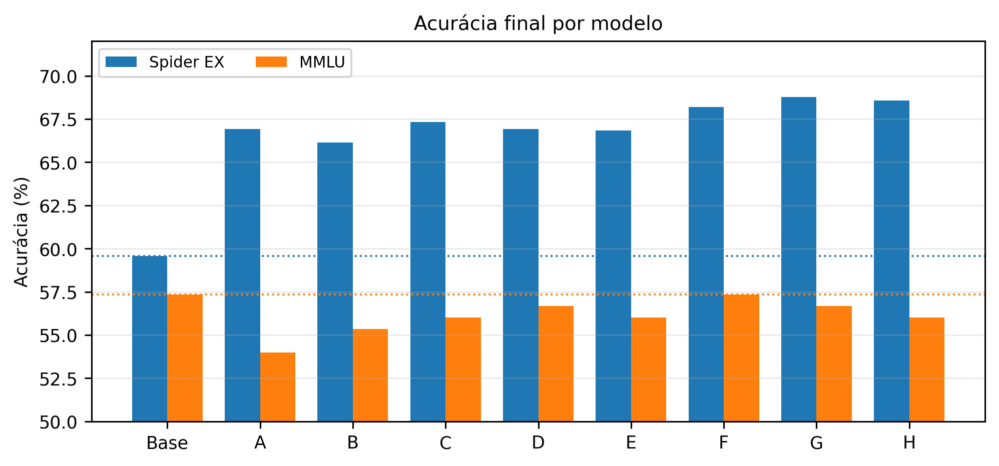

# Fine-tuning de LLM para Text-to-SQL

[**Adapter no Hugging Face**](https://huggingface.co/mh131105/qwen2.5-3b-text-to-sql-lora-exp-f) · [Relatório final](reports/relatorio_final.pdf) · [Experimentos](docs/experimentos.md) · [Reproduzir](docs/reproducao.md)

**Quanto ganho em Text-to-SQL consigo obter com LoRA e qual é o custo observado em uma avaliação auxiliar de conhecimento geral?** Investiguei essa pergunta com o `Qwen/Qwen2.5-3B-Instruct`, o Spider e uma suíte fixa de 150 questões do MMLU. Preparei os dados, implementei o pipeline de treinamento e avaliação e comparei oito configurações LoRA com o modelo-base.

O trabalho faz parte do TP2 de NLP da Universidade Federal do Amazonas, disciplinas ICC220 / PPGINF528, semestre 2026/01.

## Resultados e escolha do adapter

Escolhi o **Exp F** como compromisso: obtive **68,18% no Spider dev**, ganho de **8,61 pontos percentuais** sobre a base, e mantive os mesmos **86 acertos em 150 questões** na suíte MMLU. O **Exp G** alcançou o maior resultado Spider, com seis acertos a mais que F, e acertou uma questão MMLU a menos.

| Modelo | Spider: execução local | Corretas | Ganho sobre a base | MMLU 150 | Corretas |
| --- | ---: | ---: | ---: | ---: | ---: |
| Qwen2.5-3B-Instruct, base | 59,57% | 616/1034 | — | 57,33% | 86/150 |
| **Exp F, adapter escolhido** | **68,18%** | **705/1034** | **+8,61 p.p.** | **57,33%** | **86/150** |
| Exp G, maior resultado Spider | 68,76% | 711/1034 | +9,19 p.p. | 56,67% | 85/150 |

Todos os adapters A–H superaram a base no Spider; os ganhos variaram de 6,58 a 9,19 p.p. As diferenças entre os adapters foram menores que o ganho sobre a base. Usei o próprio Spider dev para comparar as configurações e orientar a escolha, portanto esses números não são uma estimativa em teste independente após a seleção.



Na [análise dos experimentos](docs/experimentos.md), apresento a tabela completa, as comparações de hiperparâmetros e os erros observados. Preservei o [relatório original](reports/relatorio_final.pdf), as [evidências de avaliação](reports/evaluation/) e a [execução histórica do Colab](notebooks/archive/colab_runner_executed.ipynb). A [revisão técnica](docs/revisao-tecnica.md) distingue o que conferi nos artefatos do que consta apenas no relatório ou no notebook.

## O que fiz e o que aprendi

- Implementei CLIs para preparar Spider e MMLU, treinar adapters e avaliar a base e os modelos ajustados com o mesmo protocolo.
- Comparei módulos `q/v` e `q/k/v/o`, learning rates `1e-4` e `2e-4` e treinos de uma a três épocas. No Exp F, usei `q/k/v/o`, `2e-4` e duas épocas.
- Treinei com loss apenas na SQL esperada, usando uma máscara explícita de completion e o EOS `<|im_end|>`. Na A100, usei BF16 sem quantização, microbatch 2 e acumulação 8, mantendo batch efetivo 16.
- Separei redução da loss de treino de melhora na avaliação. O Exp H teve a menor loss, mas não liderou Spider nem MMLU. Também não encontrei um efeito universal de adaptar mais módulos.

O resultado sustenta ganho na tarefa-alvo nas condições avaliadas. O empate agregado de F com a base no MMLU envolve trocas de acertos entre questões e não demonstra preservação de toda a capacidade geral.

## Dados, método e alcance das métricas

Usei **Spider train** para fine-tuning e para os três exemplos few-shot da avaliação. Avaliei nos **1034 exemplos de Spider dev**, com o esquema do banco no prompt e geração greedy. Os exemplos de avaliação não entram no treinamento supervisionado. As configurações finais compartilham seed 42, rank 16, alpha 32 e dropout 0,05.

A métrica [ExecutionAccuracy](custom_metrics/execution_accuracy.py) extrai a SQL da resposta e executa previsão e referência no SQLite correspondente, em modo de leitura. Compara as tuplas resultantes, ignora a ordem das linhas quando nenhuma consulta contém `ORDER BY` e preserva a ordem das colunas. Erros de extração, execução ou resultados diferentes recebem zero. **Esta é a implementação local de execução; não é o avaliador oficial de Test Suite Accuracy do Spider.**

Para o MMLU, usei 50 questões de cada subcategoria: `college_computer_science`, `philosophy` e `econometrics`, com cinco exemplos por subcategoria. A [suíte persistida](reports/evaluation/mmlu_150_suite.json) mantém as mesmas questões e exemplos entre os modelos. **MMLU 150 descreve esse recorte de três subcategorias, não o benchmark completo.** Uma questão corresponde a 0,67 p.p.; diferenças de poucos itens oferecem pouca resolução para ordenar capacidade geral.

## Usar o adapter

O artefato é um **adapter LoRA/PEFT**, que precisa do modelo-base `Qwen/Qwen2.5-3B-Instruct`. Ele não contém uma cópia completa dos pesos da base. A licença Qwen Research restringe o uso a fins não comerciais; consulte a [model card](https://huggingface.co/mh131105/qwen2.5-3b-text-to-sql-lora-exp-f). **Built with Qwen.**

Na raiz do repositório, em um ambiente Python com memória suficiente para a base de 3B:

```sh
python -m pip install -r requirements-inference.txt
python examples/infer_exp_f.py \
  --adapter mh131105/qwen2.5-3b-text-to-sql-lora-exp-f
```

O exemplo carrega a base e o adapter e gera SQL para uma pergunta e um esquema pequenos. Para fixar o artefato, use `--revision` com o commit do Hub; `--device cuda`, `--device mps` ou `--device cpu` escolhe o dispositivo. A demonstração de inferência não substitui a avaliação Spider com três exemplos few-shot. Os detalhes de validação do upload ficam em [publicação](docs/publicacao.md).

## Caminho mínimo para reproduzir

O ambiente do experimento foi Google Colab com A100 de 40 GB. O [notebook atual](notebooks/colab_runner.ipynb) executa as mesmas CLIs abaixo. As versões e os passos para obter os dados e restaurar o adapter estão em [reprodução](docs/reproducao.md).

```sh
git clone --branch pipeline --single-branch \
  https://github.com/mh131105/Fine-tuning-de-LLM-para-Text-to-SQL.git
cd Fine-tuning-de-LLM-para-Text-to-SQL
python -m pip install -r requirements.txt
python -m scripts.prepare_spider \
  --data_dir data/raw/spider --output_dir data/processed/spider
mkdir -p data/processed
cp reports/evaluation/mmlu_150_suite.json data/processed/mmlu_150_suite.json
python -m scripts.run_benchmarks --config configs/eval.yaml --model_path outputs/base
python -m scripts.train --config configs/train_lora_exp_f.yaml
python -m scripts.run_benchmarks --config configs/eval.yaml --model_path outputs/exp_f
```

Esse caminho treina F novamente. Para avaliar o adapter já publicado, siga a alternativa de download em [reprodução](docs/reproducao.md). Para conferir o código sem baixar o Qwen, execute `python -m pytest`; os testes usam casos pequenos e mocks, sem validar as acurácias experimentais.

## Limitações

- Avaliei um modelo-base, uma seed e um conjunto limitado de configurações. Usei Spider dev na seleção; não reservei outro conjunto para medir o desempenho da escolha final.
- A suíte MMLU tem 150 questões em três subcategorias. Igualar a média da base nesse recorte não comprova ausência de regressões em outras tarefas.
- A comparação por execução depende do conteúdo de cada banco. Ela pode considerar iguais consultas que coincidem nessa instância e penaliza troca de colunas, mesmo quando a agregação pretendida parece equivalente.
- Spider e MMLU são públicos. Não consigo excluir exposição do modelo-base a esses dados no pré-treino.
- Permaneceram erros de ligação entre pergunta e esquema e consultas executáveis com resultados incorretos. A geração de SQL não dispensa revisão antes de uso em um banco real.

## Organização, autoria e licenças

| Caminho | Conteúdo |
| --- | --- |
| [`reports/`](reports/) | Relatório final, figuras e evidências preservadas. |
| [`docs/`](docs/) | Experimentos, reprodução, revisão técnica e publicação. |
| [`configs/`](configs/) | Configurações A–H, avaliação e alternativas identificadas como exploratórias. |
| [`src/`](src/), [`scripts/`](scripts/) e [`custom_metrics/`](custom_metrics/) | Implementação, CLIs e métrica de execução. |
| [`examples/`](examples/) | Exemplo de inferência com o adapter. |
| [`notebooks/`](notebooks/) | Runner atual e execução histórica arquivada. |
| [`data/`](data/) e [`outputs/`](outputs/) | Dados e saídas de runtime, fora do Git, com documentação própria. |
| [`tests/`](tests/) | Testes de preparação, prompts, extração, execução e encadeamento. |

Sou Matheus Garcia, autor identificado no relatório e no histórico do projeto. Nesta revisão de apresentação e disponibilização dos artefatos, usei assistência do Codex para conferir evidências, revisar a documentação e preparar a publicação. Essa declaração descreve a revisão atual; não atribui retroativamente às ferramentas a execução dos experimentos originais.

O [código usa licença MIT](LICENSE). O modelo-base e o adapter seguem as condições Qwen Research, com uso não comercial. Spider, MMLU e as bibliotecas mantêm suas licenças e atribuições próprias, detalhadas na [documentação da publicação](docs/publicacao.md).
