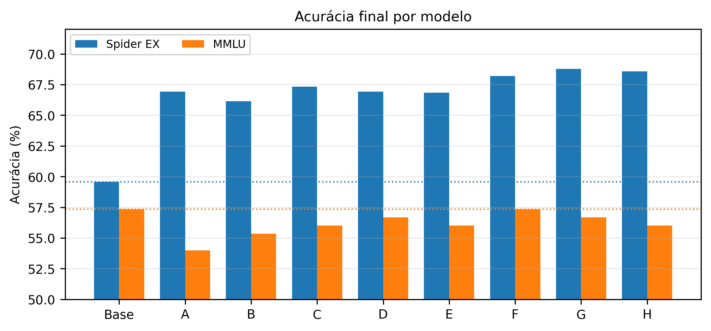

# Experimentos e avaliação

O estudo compara oito configurações LoRA do `Qwen/Qwen2.5-3B-Instruct` para investigar o ganho em Text-to-SQL e a possível regressão em uma medida auxiliar de conhecimento geral. O [relatório final](../reports/relatorio_final.pdf) registra a análise original. Este documento reúne as configurações, o alcance das métricas e as evidências dos experimentos.

## Decisão sobre o artefato

O **Exp F** foi selecionado para publicação por aumentar a acurácia de execução no Spider de 59,57% para 68,18%, mantendo 86 acertos em 150 questões da suíte MMLU. A seleção segue a recomendação conservadora da seção 6.1 do relatório.

O **Exp G** chegou a 68,76% no Spider, seis acertos acima de F, e acertou uma questão MMLU a menos. Ele é a alternativa registrada no relatório para priorizar a tarefa de Text-to-SQL. Essa diferença pequena não sustenta uma conclusão ampla sobre a capacidade geral dos modelos.

## Dados e treinamento

O treinamento utilizou 7.000 exemplos de `train_spider.json`. O preparo registrado no notebook encontrou 1.034 exemplos em `dev` e 166 esquemas, sem bancos ausentes ou ilegíveis. A execução recuperou os arquivos por `dreamerdeo/multispider`. O código usa `train_spider.json`; não incorpora automaticamente `train_others.json`.

Os dados de treinamento seguem o formato prompt e completion, com loss apenas nos tokens da SQL esperada e EOS `<|im_end|>`. O código constrói uma `completion_mask` explícita e trunca as sequências em 2.048 tokens. No treino, o prompt não contém exemplos few-shot; na avaliação Spider, ele contém três exemplos de treino.

Os experimentos finais foram executados em Colab com A100-SXM4-40GB, LoRA em BF16 e sem quantização. O relatório registra o ajuste do microbatch para caber na GPU. As configurações compartilham microbatch 2 e acumulação 8, batch efetivo 16, `adamw_torch_fused`, warmup 0,03, weight decay 0, TF32 e agrupamento por comprimento. Todos usam seed 42, rank 16, alpha 32 e dropout 0,05.

| Exp. | Módulos | Learning rate | Épocas | Train loss | Tempo aproximado |
| --- | --- | ---: | ---: | ---: | ---: |
| [A](../configs/train_lora_exp_a.yaml) | q/v | 1e-4 | 1 | 0,309 | 11,0 min |
| [B](../configs/train_lora_exp_b.yaml) | q/k/v/o | 1e-4 | 1 | 0,260 | 14,0 min |
| [C](../configs/train_lora_exp_c.yaml) | q/k/v/o | 1e-4 | 2 | 0,199 | 28,2 min |
| [D](../configs/train_lora_exp_d.yaml) | q/k/v/o | 2e-4 | 1 | 0,226 | 14,2 min |
| [E](../configs/train_lora_exp_e.yaml) | q/v | 1e-4 | 2 | 0,240 | 21,6 min |
| [F](../configs/train_lora_exp_f.yaml) | q/k/v/o | 2e-4 | 2 | 0,168 | 27,6 min |
| [G](../configs/train_lora_exp_g.yaml) | q/k/v/o | 1e-4 | 3 | 0,164 | 41,3 min |
| [H](../configs/train_lora_exp_h.yaml) | q/k/v/o | 2e-4 | 3 | 0,135 | 41,7 min |

As abreviações indicam `q_proj`, `k_proj`, `v_proj` e `o_proj`. A [configuração exploratória I](../configs/train_lora_exp_i_exploratory.yaml), com quatro épocas, e o [template QLoRA para T4](../configs/train_qlora_t4_template.yaml) ficam disponíveis como materiais complementares. Não há resultados deles na comparação final do relatório.

O ambiente registrado para F contém Python 3.12.13, PyTorch 2.11.0+cu128, Transformers 4.57.6, PEFT 0.19.1, TRL 0.29.1, Datasets 4.8.5, DeepEval 3.9.9 e bitsandbytes 0.49.2. Consulte o [registro original](../reports/evaluation/exp_f/environment.json) e as [dependências](../requirements.txt). O arquivo de dependências não fixa PyTorch; a execução original usou a instalação CUDA do Colab.

## Protocolo Spider

A avaliação dos 1.034 exemplos de `dev` utilizou a mesma [configuração](../configs/eval.yaml), [construção de prompt](../src/prompts.py) e métrica para a base e os adapters. O prompt é texto simples: instrução, os três primeiros exemplos de `train` com seus esquemas, esquema do banco-alvo e pergunta final. O código não aplica um chat template. O limite é de 256 novos tokens, com geração greedy (`do_sample=false`). O código corta as stop sequences no texto decodificado após a geração.

A [ExecutionAccuracy](../custom_metrics/execution_accuracy.py) é uma implementação própria compatível com a interface de métricas do DeepEval. Para cada exemplo, ela:

1. Extrai a primeira consulta `SELECT` ou `WITH`, removendo cercas Markdown e continuações reconhecidas de prompt ou explicação.
2. Bloqueia consultas fora da política de leitura e executa previsão e referência no mesmo arquivo SQLite, em modo somente leitura, com `PRAGMA query_only` e timeout de cinco segundos por consulta.
3. Normaliza bytes para texto e arredonda floats em seis casas decimais.
4. Compara as tuplas retornadas. Preserva duplicatas e a ordem das colunas. Ignora a ordem das linhas quando nenhuma das duas consultas contém `ORDER BY`; caso contrário, preserva a ordem.

O score é binário. Falhas de extração, execução, segurança, timeout ou resultado diferente recebem zero. A média desses scores é a acurácia apresentada. Consulte os [utilitários SQL](../src/sql_utils.py) para os detalhes.

Essa avaliação usa uma instância de banco por exemplo. A equivalência dos resultados nessa instância não demonstra equivalência semântica para todos os bancos possíveis. Também não corresponde ao avaliador oficial do Spider nem à test-suite accuracy. A posição das colunas pode penalizar SQLs que recuperam os mesmos atributos em outra ordem, como no exemplo de agregação discutido no relatório.

## Protocolo MMLU 150

A avaliação MMLU utilizou `cais/mmlu`, com 50 questões de `test` em cada uma de três subcategorias: `college_computer_science`, `philosophy` e `econometrics`. As etiquetas STEM, Humanidades e Sociais representam essas subcategorias específicas. Cada prompt contém cinco exemplos de `dev` da respectiva subcategoria e pede uma letra A, B, C ou D. A geração permite quatro novos tokens; o parser extrai a alternativa e compara com o gabarito.

O preparo usa amostragem com seed 42, acrescida do índice da categoria; os few-shot usam seed 1042 acrescida desse índice. A [suíte utilizada](../reports/evaluation/mmlu_150_suite.json) está preservada, com o hash de questões registrado na execução:

```text
8fc4621bde8bba56f49b1d9d4e26d50777653a583b46120e82979ce321e8cc6b
```

Esse valor vem do algoritmo em `src/preparation.py`; ele não é o hash SHA-256 do arquivo JSON inteiro e não cobre os exemplos few-shot. Uma questão corresponde a 0,67 ponto percentual. A suíte funciona como verificação auxiliar de regressão. Ela não estima o MMLU completo nem demonstra preservação de capacidades gerais fora desse recorte.

## Resultados finais

| Modelo | Spider: acertos/1.034 | Spider EX | Δ Spider | MMLU: acertos/150 | MMLU 150 | Δ MMLU |
| --- | ---: | ---: | ---: | ---: | ---: | ---: |
| Base | 616 | 59,57% | 0,00 p.p. | 86 | 57,33% | 0,00 p.p. |
| A | 692 | 66,92% | +7,35 p.p. | 81 | 54,00% | −3,33 p.p. |
| B | 684 | 66,15% | +6,58 p.p. | 83 | 55,33% | −2,00 p.p. |
| C | 696 | 67,31% | +7,74 p.p. | 84 | 56,00% | −1,33 p.p. |
| D | 692 | 66,92% | +7,35 p.p. | 85 | 56,67% | −0,67 p.p. |
| E | 691 | 66,83% | +7,25 p.p. | 84 | 56,00% | −1,33 p.p. |
| F | 705 | 68,18% | +8,61 p.p. | 86 | 57,33% | 0,00 p.p. |
| G | 711 | 68,76% | +9,19 p.p. | 85 | 56,67% | −0,67 p.p. |
| H | 709 | 68,57% | +8,99 p.p. | 84 | 56,00% | −1,33 p.p. |

As contagens do relatório conferem com as saídas persistidas do [notebook executado](../notebooks/archive/colab_runner_executed.ipynb). Para E/F/G/H, a auditoria também recalculou os agregados a partir das predições originais recuperadas dos backups. A [revisão técnica](revisao-tecnica.md) distingue essas duas fontes de evidência.



## Análise dos resultados

Os oito adapters superaram a base na tarefa-alvo. A duração do treinamento em q/k/v/o produziu a tendência mais consistente: de B para C para G, Spider subiu de 66,15% para 67,31% e 68,76%. Em LR 2e-4, D/F/H chegaram a 66,92%, 68,18% e 68,57%; a terceira época acrescentou quatro acertos no Spider e perdeu dois na suíte MMLU em relação a F.

A troca isolada de q/v para q/k/v/o teve efeito ambíguo. Com uma época, B ficou oito acertos abaixo de A no Spider; com duas épocas, C ficou cinco acima de E. A menor loss de treino não correspondeu ao melhor resultado de avaliação: H teve a menor loss, mas G obteve mais acertos no Spider e F manteve a acurácia agregada MMLU da base.

O empate MMLU de F com a base contém diferenças por categoria: STEM passou de 32 para 29 acertos, Humanidades de 28 para 32 e Sociais de 26 para 25. A soma igual não significa respostas idênticas ou ausência de regressão por categoria.

No Spider, F terminou com 85 erros de execução e 244 resultados diferentes da referência. G teve 95 e 228, respectivamente. A base final registrou 163 erros de execução e 255 diferenças de resultado. O fine-tuning reduziu consultas que falham ao executar; SQL executável com interpretação incorreta continuou sendo uma limitação. O relatório descreve erros de schema linking, agregação e ordem das colunas.

## Limites e auditoria

A configuração foi selecionada a partir dos resultados no mesmo `dev` utilizado na avaliação. Esse recorte, uma única seed e a possibilidade de contato dos modelos com benchmarks públicos no pré-treino limitam a generalização das conclusões. Não há aqui avaliação independente de produção, de outros idiomas, de outros dialetos SQL ou de robustez em esquemas externos.

O relatório também registra testes pareados e a análise de 74 questões acertadas por todos, 58 erradas por todos e 18 que diferenciaram os modelos no MMLU. Essas análises permanecem no PDF. As predições finais da base e de A–D não estavam nos backups recuperados; por isso, a revisão atual não revalidou esses cálculos por exemplo.

Para conferir os agregados versionados sem baixar modelo, instalar dependências de treinamento ou executar SQL:

```sh
python3 -m scripts.audit_evidence
```

Esse comando usa apenas a biblioteca padrão. Ele verifica scores e rótulos salvos, totais, IDs, categorias, hash da suíte, consistência dos hashes de prompt entre E/F/G/H e correspondência com o notebook original. Ele não repete inferência, não reexecuta as SQLs e não reconstrói os testes pareados finais sem as predições ausentes. O [README](../README.md) apresenta o caminho de uso e reprodução.
